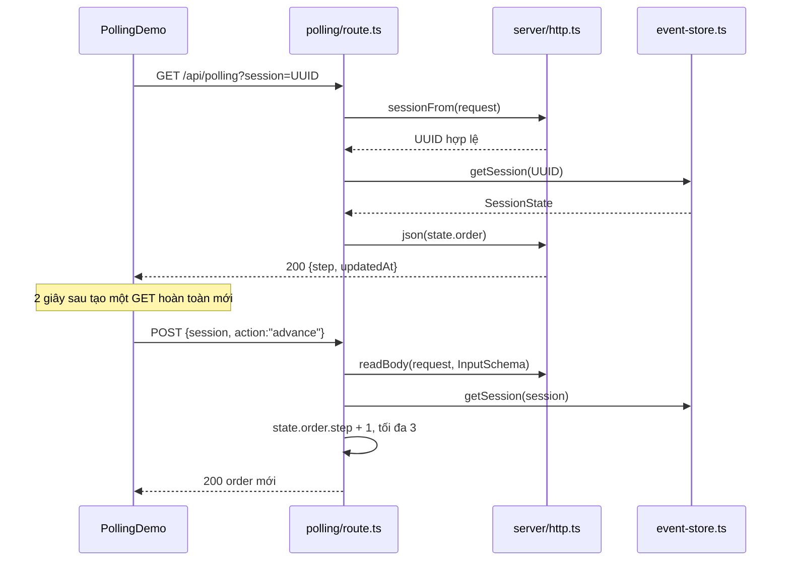
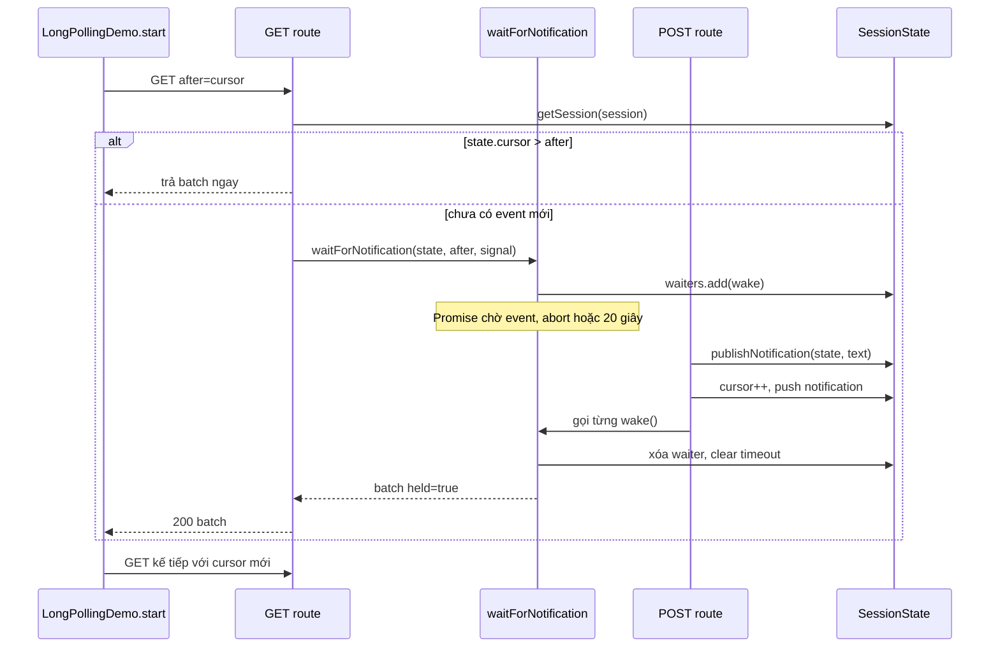
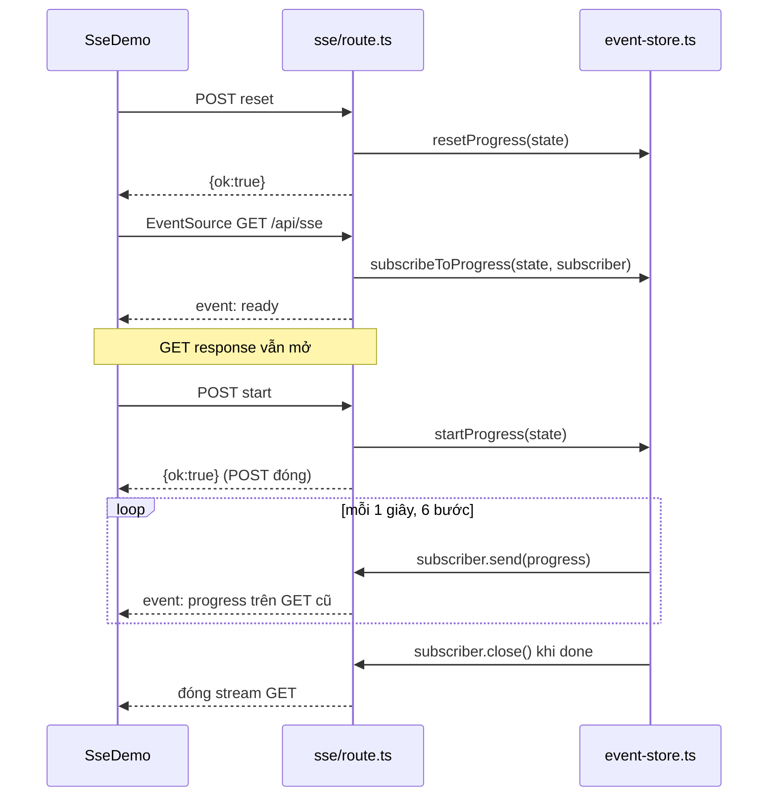
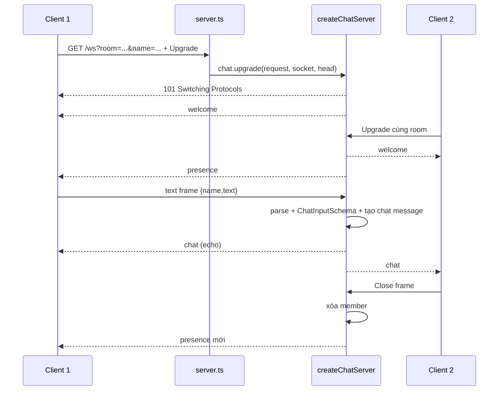
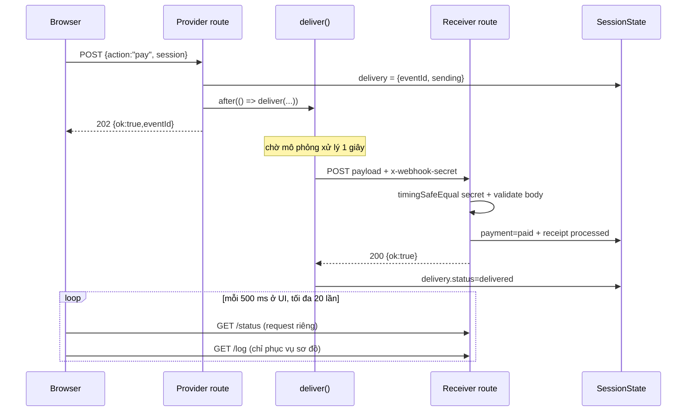

# Backend ProtoLab hoạt động như thế nào

Tài liệu này đi từ thao tác trên giao diện đến đúng function backend xử lý nó. Mục tiêu không chỉ là biết endpoint nào được gọi, mà hiểu **state nằm ở đâu, request sống bao lâu, function nào đánh thức function nào, dữ liệu được kiểm tra ra sao và vì sao từng cơ chế hoạt động**.

> Phạm vi: đúng với source hiện tại của ProtoLab. Đây là demo localhost chạy trong **một Node.js process**; không phải kiến trúc production nhiều instance.

## Bức tranh chung trước khi đi vào 5 cơ chế

### 1. Một custom server đứng trước Next.js 

Điểm khởi động là `server.ts`:

1. `main()` tạo Next app bằng `next({ dev, hostname, port })` rồi `await app.prepare()`.
2. `app.getRequestHandler()` trả về `handle`, dùng để chuyển các HTTP request thông thường vào Next.js. Vì vậy các file `src/app/api/**/route.ts` mới nhận được request.
3. `createServer(...)` tạo Node HTTP server thật. Server chỉ chấp nhận header `Host` là `127.0.0.1:<port>` hoặc `localhost:<port>`.
4. Event `upgrade` được xử lý riêng. Nếu pathname là `/ws`, request được chuyển vào `createChatServer().upgrade(...)`; các upgrade khác được trả lại cho Next qua `nextUpgrade` để hot reload vẫn chạy.
5. Khi nhận `SIGINT` hoặc `SIGTERM`, `shutdown()` đóng WebSocket, HTTP server và Next app.

Vì WebSocket cần bắt HTTP Upgrade ngay ở tầng Node server, project phải chạy bằng `npm run dev` hoặc `npm start`. Chạy `next dev` trực tiếp sẽ bỏ qua phần `/ws` trong `server.ts`.

### 2. `session`: khóa liên kết các request rời rạc

`ProtocolTabs` tạo một UUID bằng `crypto.randomUUID()` và truyền cùng giá trị đó vào demo đang mở. Với HTTP, Long Polling, SSE và Webhook, UUID này đi trong query string hoặc JSON body. `SessionSchema = z.string().uuid()` bảo đảm nó thực sự là UUID.

`getSession(id)` trong `src/server/event-store.ts` dùng UUID làm key của singleton:

```ts
Map<string, SessionState>
```

Singleton được đặt trên `globalThis.protoLabSessions`, giúp state không dễ bị tạo lại khi module được nạp lại trong môi trường Next development. Nó vẫn chỉ là memory của **một process**: restart server là mất dữ liệu; chạy nhiều instance thì mỗi instance có state riêng.

Một `SessionState` gom state của bốn demo dùng Route Handler:

```ts
{
  touchedAt,                 // lần gần nhất getSession() chạm tới phiên
  order,                     // Polling
  notifications, cursor,
  waiters,                   // Long Polling
  progress, subscribers,
  timer,                     // SSE
  payment, webhooks,
  delivery                   // Webhook
}
```

`getSession()` còn thực hiện housekeeping mỗi lần được gọi:

- xóa phiên không hoạt động quá `3_600_000 ms` (1 giờ), nhưng chỉ khi phiên không có long-poll waiter, SSE subscriber hoặc webhook đang `sending`;
- `clearInterval(state.timer)` trước khi xóa phiên;
- từ chối tạo phiên thứ 1.001 bằng HTTP `503`;
- tạo state mặc định nếu UUID chưa tồn tại và cập nhật `touchedAt`.

WebSocket không dùng `SessionState`. Nó có map riêng `rooms` trong `src/server/websocket.ts`; query `room` vẫn là UUID nhưng chỉ đóng vai trò tên phòng chat.

### 3. Các contract và lớp bảo vệ HTTP dùng chung

`src/lib/protocol-contracts.ts` là nơi tập trung các shape dữ liệu được chia sẻ giữa backend và frontend. Một số schema chỉ dùng cục bộ — như `InputSchema`/`AckSchema` trong route và `OkSchema`/`ErrorSchema` trong component — được đặt ngay cạnh code sử dụng chúng. Zod được dùng ở cả backend và frontend: backend kiểm tra input, frontend kiểm tra response/event trước khi tin dữ liệu.

Các helper trong `src/server/http.ts`:

- `json(data, status)`: tạo JSON response và luôn thêm `Cache-Control: no-store`.
- `sessionFrom(request)`: đọc `?session=...`, validate bằng `SessionSchema`; sai thì ném một `Response` 400.
- `readBody(request, schema)`: kiểm tra Origin nếu có, bắt buộc `Content-Type: application/json`, đọc stream body với giới hạn **4 KB**, parse JSON rồi validate Zod.
- `isLocalOrigin(origin)`: chỉ chấp nhận đúng origin local ứng với port đang chạy.
- `errorResponse(error)`: nếu lỗi chính là một `Response` có chủ đích thì trả nguyên response; lỗi bất ngờ được log và đổi thành JSON 500 chung, tránh lộ chi tiết nội bộ.

Việc `throw json(...)` có vẻ lạ nhưng hợp lệ vì JavaScript cho phép throw bất kỳ giá trị nào. `errorResponse()` nhận ra `Response` và dùng nó như kết quả HTTP.

---

## Phần 1 — Polling: client hỏi trạng thái theo chu kỳ

### Cốt lõi

Polling không tạo kết nối “đặc biệt”. Cứ mỗi 2 giây, browser tạo **một GET request mới**, server đọc trạng thái hiện tại rồi đóng response. Nếu state không đổi, request vẫn tốn một lượt đi/về và trả lại dữ liệu cũ. Đây chính là đặc điểm cần quan sát trong demo.

### Điểm vào và dữ liệu

| Vai trò | Điểm vào | Ý nghĩa |
| --- | --- | --- |
| Frontend | `PollingDemo()` | Bật/tắt vòng lặp hỏi trạng thái và mô phỏng cửa hàng đổi state |
| Đọc | `GET /api/polling?session=<UUID>` | Trả `state.order` hiện tại |
| Ghi | `POST /api/polling` | `action: "advance"` hoặc `"reset"` |
| Backend state | `SessionState.order` | `{ step: 0..3, updatedAt: ISO datetime }` |

`step` ánh xạ sang bốn nhãn ở frontend: `0 Đã tiếp nhận`, `1 Đang chuẩn bị`, `2 Đang giao hàng`, `3 Đã giao hàng`.

### Call flow: từ nút bấm đến response



### Từng function quan trọng làm gì

#### `PollingDemo()` và effect polling

Khi `running` thành `true`, `useEffect`:

1. tạo một `AbortController` dùng chung cho vòng theo dõi hiện tại;
2. khai báo `poll()`;
3. gọi `poll()` ngay, không bắt người dùng đợi 2 giây đầu;
4. tạo `setInterval(() => poll(), 2000)`.

Biến cục bộ `busy` chống chồng request. Nếu một GET mất hơn 2 giây, tick kế tiếp thấy `busy === true` và bỏ qua; do đó demo không tạo nhiều GET đồng thời ngoài ý muốn.

Sau response, frontend parse bằng `OrderSchema`, cập nhật UI, và so `nextOrder.step` với `seen.current`. So sánh này chỉ để ghi log “không đổi” hay “trạng thái mới”; server không thực hiện conditional request. Khi `step === 3`, frontend đặt `running = false`, khiến cleanup effect chạy, xóa interval và abort request còn lại.

#### `GET()` trong `polling/route.ts`

Đây là route rất ngắn vì toàn bộ việc chung đã được tách ra:

```text
sessionFrom(request)
  → getSession(sessionId)
    → lấy .order
      → json(order)
```

`dynamic = "force-dynamic"`, `Cache-Control: no-store` ở response và `cache: "no-store"` ở fetch cùng thể hiện ý định: mỗi GET phải đọc state hiện tại, không dùng cache.

#### `advance()` ở frontend và `POST()` ở route

Nút “Chuyển trạng thái” gọi `advance()`, gửi:

```json
{ "session": "<UUID>", "action": "advance" }
```

Route dùng `InputSchema`, rồi gán một object `order` mới:

```ts
step: Math.min(state.order.step + 1, 3)
updatedAt: new Date().toISOString()
```

`Math.min(..., 3)` giữ invariant `step <= 3`. Response POST được frontend dùng để cập nhật riêng vùng mô phỏng “cửa hàng” (`serverStep`). Vùng “khách hàng” không lấy ngay kết quả này; nó chỉ thay đổi ở GET polling tiếp theo. Cách tách đó giúp nhìn rõ độ trễ của polling.

Route cũng hỗ trợ `action: "reset"`, nhưng nút “Đặt lại” chung của UI hiện tại tạo UUID phiên mới thay vì gọi action này.

### Vòng đời, cleanup và lỗi

- Mỗi GET sống từ lúc `fetch()` đến khi nhận trọn JSON; response đóng ngay.
- Dừng theo dõi, đổi tab hoặc unmount sẽ `clearInterval()` và `abort.abort()`.
- `busy` được trả về `false` trong `finally`, kể cả khi request lỗi.
- HTTP không phải 2xx, JSON sai schema hoặc lỗi mạng làm dừng polling và hiện lỗi.
- POST mutation có `AbortController` riêng; unmount sẽ abort nó.
- Backend trả 400 cho session/body sai, 403 cho Origin lạ, 415 cho body không phải JSON, 413 nếu quá 4 KB.

### Timeline cụ thể

```text
t=0.0s  Bấm “Bắt đầu theo dõi” → GET #1 → step 0.
t=2.0s  GET #2 → vẫn step 0; đây là một request hữu ích về mặt kiểm tra nhưng dữ liệu không đổi.
t=2.7s  Bấm “Chuyển trạng thái” → POST → server lưu step 1.
t=4.0s  GET #3 → client lần đầu thấy step 1.
t=6.0s  GET #4 → vẫn step 1.
```

### Điểm dễ nhầm

- `setInterval(2000)` không có nghĩa là giữ một kết nối 2 giây; mỗi tick là request độc lập.
- POST đổi trạng thái là thao tác dựng kịch bản demo, không phải polling.
- `updatedAt` có thể đổi khi gọi `advance` ở step 3 dù step vẫn bị chặn tại 3.
- `serverStep` là state hiển thị phía frontend; nguồn thật backend vẫn là `state.order`.

### Tự kiểm chứng

Thay UUID bên dưới bằng một UUID bất kỳ:

```powershell
$s = [guid]::NewGuid().ToString()
curl.exe -s "http://127.0.0.1:3000/api/polling?session=$s"
curl.exe -s -X POST "http://127.0.0.1:3000/api/polling" -H "Content-Type: application/json" -d ('{"session":"' + $s + '","action":"advance"}')
curl.exe -s "http://127.0.0.1:3000/api/polling?session=$s"
```

---

## Phần 2 — Long Polling: giữ một request cho đến khi có dữ liệu

### Cốt lõi

Long Polling vẫn là HTTP request/response bình thường, nhưng server **chưa trả response ngay** nếu chưa có event mới. Nó giữ Promise tối đa 20 giây. Khi có thông báo, publisher gọi các callback đang chờ; response hoàn tất và client lập tức gửi GET kế tiếp.

### Điểm vào và dữ liệu

| Thành phần | Dữ liệu/ý nghĩa |
| --- | --- |
| `GET /api/long-polling?session=...&after=N` | Xin tất cả event có `id > N` |
| `POST /api/long-polling` | `publish` một thông báo hoặc `reset` |
| `notifications` | Tối đa 50 notification gần nhất |
| `cursor` | Số thứ tự event toàn cục trong phiên |
| `waiters: Set<() => void>` | Các callback đánh thức GET đang bị giữ |
| `NotificationBatch` | `{ events, cursor, held, timedOut }` |

Mỗi notification có `{ id, text, createdAt }`; backend chấp nhận text dài 1–240 ký tự, còn ô nhập của UI chủ động giới hạn 200 ký tự. `cursor` không phải index mảng: nó vẫn tăng dù mảng chỉ giữ 50 phần tử.

### Call flow



### Từng function quan trọng làm gì

#### `start()` ở frontend

`start()` tạo một `AbortController`, rồi chạy vòng `for` tuần tự. Trong mỗi vòng, chỉ sau khi `await fetch(...)` và xử lý batch xong nó mới quay lại gửi GET mới. Đây là điều bảo đảm **mỗi client chỉ có một long-poll GET đang chờ**.

Frontend truyền `after=${cursor.current}`. Khi nhận batch, nó gán `cursor.current = batch.cursor`, thêm event vào danh sách rồi lặp lại. Timer 300 ms phía frontend chỉ phục vụ hình minh họa “request đang được giữ”; nó không quyết định timeout backend.

Nếu backend trả `409` vì cursor của client lớn hơn cursor server — thường là server restart trong khi browser còn state cũ — client đặt cursor về 0, xóa danh sách local và dừng để người dùng biết phiên không còn đồng bộ.

#### `GET()` trong route

Route thực hiện ba lớp kiểm tra:

1. `sessionFrom()` validate UUID;
2. Zod coerce `after` thành integer không âm;
3. nếu `after > state.cursor`, trả 409 vì server không thể chứng minh các event mà client nói đã thấy.

Sau đó route `await waitForNotification(...)`. Chính `await` này giữ Route Handler chưa hoàn tất, tức response HTTP vẫn mở.

#### `waitForNotification(state, after, signal)`

Function có fast path: nếu `state.cursor > after`, event đã tồn tại nên trả `Promise.resolve(notificationBatch(...))` ngay. Nhờ vậy event phát sinh trong khe thời gian giữa hai GET không bị bỏ lỡ.

Nếu chưa có event, function tạo Promise và ba đường kết thúc cùng hội tụ vào `finish()`:

- `wake()` do publisher gọi;
- `abort()` khi `request.signal` báo client ngắt;
- `setTimeout(..., 20_000)`.

`finish()` luôn clear timeout, xóa `wake` khỏi `state.waiters`, gỡ abort listener rồi resolve batch. Việc gom cleanup vào một chỗ ngăn waiter “ma” tồn tại sau khi request đã xong.

`held: true` cho biết request từng bị giữ; `timedOut: true` chỉ có ở đường timeout 20 giây. Abort hiện cũng resolve nội bộ một batch `held: true, timedOut: false`, nhưng kết nối phía client đã hủy nên response không còn giá trị với browser.

#### `publishNotification(state, text?)`

Function luôn tăng `cursor` trước. Với `publish`, nó push notification mới rồi chỉ giữ 50 item cuối. Với `reset` (`text` không có), nó xóa mảng notifications nhưng vẫn tăng cursor. Sau đó nó gọi toàn bộ `wake` trong `waiters`; mỗi waiter tự xóa chính mình qua `finish()`.

POST trả `notificationBatch(state, 0)`. Response này xác nhận thao tác tạo event; dữ liệu tới listener thực sự đi qua GET đang được giữ.

### Vòng đời, timeout, cleanup và lỗi

- Một GET tối đa khoảng 20 giây nếu không có event, sau đó trả 200 với `timedOut: true`; timeout không phải lỗi.
- Client nhận timeout xong gửi GET mới ngay.
- Nút dừng hoặc unmount gọi `AbortController.abort()`; backend thấy `request.signal` và giải phóng waiter.
- Publish có controller riêng để không làm việc dừng listener vô tình hủy POST đang gửi.
- `notifications` chỉ giữ 50 event; client bị tụt quá xa có thể không lấy lại những item đã bị cắt dù cursor vẫn đúng. Demo không có cơ chế “cursor too old”.

### Timeline cụ thể

```text
t=0s    GET after=0; cursor server=0 → server thêm wake vào waiters.
t=4s    POST publish “A” → cursor=1, lưu event id=1, gọi wake.
t=4s    GET trả {events:[A], cursor:1, held:true, timedOut:false}.
t=4s+   Client lập tức GET after=1 → lại được giữ.
t=24s   Không có event → 200 {events:[], cursor:1, held:true, timedOut:true}.
t=24s+  Client GET after=1 lần nữa.
```

### Điểm dễ nhầm

- Long Polling không phải streaming: mỗi response vẫn kết thúc sau một batch.
- Callback `wake` không mang payload; nó chỉ làm Promise đọc lại `state.notifications` bằng `notificationBatch()`.
- Cursor giải quyết khoảng trống giữa hai request; nếu event đã có trước GET mới, fast path trả ngay.
- POST publish là nguồn tạo event mô phỏng, không phải đường client nhận event.

### Tự kiểm chứng

Mở terminal A (lệnh sẽ chờ):

```powershell
$s = "11111111-1111-4111-8111-111111111111"
curl.exe -i -N "http://127.0.0.1:3000/api/long-polling?session=$s&after=0"
```

Trong vòng 20 giây, terminal B:

```powershell
$s = "11111111-1111-4111-8111-111111111111"
curl.exe -s -X POST "http://127.0.0.1:3000/api/long-polling" -H "Content-Type: application/json" -d ('{"session":"' + $s + '","action":"publish","text":"Xin chao"}')
```

Terminal A sẽ hoàn tất ngay thay vì đợi đủ 20 giây.

---

## Phần 3 — Server-Sent Events (SSE): nhiều event trong một response

### Cốt lõi

SSE dùng một GET HTTP nhưng response body là stream. Server trả header `text/event-stream`, giữ response mở và `enqueue` nhiều frame văn bản. Chiều dữ liệu trên kết nối SSE là **server → client**; demo dùng một POST riêng để ra lệnh bắt đầu tác vụ.

### Điểm vào và state

| Thành phần | Vai trò |
| --- | --- |
| `GET /api/sse?session=...` | Mở `ReadableStream`, đăng ký subscriber |
| `POST /api/sse {action:"reset"}` | Đưa progress về ban đầu |
| `POST /api/sse {action:"start"}` | Khởi chạy timer nếu đã có subscriber |
| `progress` | `{ progress, step, done }` mới nhất |
| `subscribers` | Set các object `{ send, close }` |
| `timer` | Interval 1 giây tạo tiến độ |

Frame đúng chuẩn SSE được tạo dạng:

```text
event: progress
data: {"progress":17,"step":"Truy xuất dữ liệu","done":false}
```

Dòng trống cuối cùng kết thúc một event.

### Call flow



### Từng function quan trọng làm gì

#### `SseDemo.start()`

Trình tự cố ý là:

1. POST `reset` để hủy timer cũ và đưa progress về 0;
2. tạo `new EventSource(...)`;
3. đợi named event `ready`;
4. chỉ khi nhận `ready` mới POST `start`.

Nếu POST `start` chạy trước khi GET đăng ký subscriber, route chủ động trả `409` với thông báo cần mở kết nối SSE trước; timer chưa được tạo. Event `ready` là handshake ở tầng ứng dụng để frontend biết subscriber đã được thêm vào `state.subscribers`, nhờ đó POST `start` không vướng nhánh bảo vệ này và không thể phát event trước khi client sẵn sàng nhận.

`EventSource` tự parse format SSE. Listener `progress` parse `event.data` bằng `ProgressSchema`. Khi `done === true`, frontend chủ động `source.close()` vì EventSource mặc định có xu hướng tự reconnect khi stream đóng.

#### `GET()` và `ReadableStream`

Trong `start(controller)` của stream, route tạo:

- `send(event, data)`: encode frame rồi `controller.enqueue(...)`;
- `finish(closeStream)`: bảo đảm cleanup chỉ chạy một lần, unsubscribe, gỡ abort listener và tùy trường hợp đóng controller;
- `close()`: dùng khi server muốn kết thúc stream hoặc client abort;
- `cleanup()`: dùng bởi `ReadableStream.cancel()` nhưng không gọi `controller.close()` lần nữa.

Subscriber được đăng ký trước khi `send("ready", {})`, nên khi client thấy `ready`, backend chắc chắn đã có nơi nhận progress.

Headers quan trọng:

- `Content-Type: text/event-stream; charset=utf-8`: browser biết đây là SSE;
- `Cache-Control: no-cache, no-transform`: không cache/biến đổi stream;
- `Connection: keep-alive`: thể hiện ý định giữ connection;
- `X-Accel-Buffering: no`: yêu cầu reverse proxy tương thích không gom event thành cục.

#### `subscribeToProgress()`

Function thêm subscriber vào Set và trả closure `unsubscribe()`. Khi subscriber cuối cùng rời đi, closure clear `state.timer`. Vì vậy tác vụ demo không tiếp tục chạy vô ích nếu không còn ai nghe.

#### `resetProgress()`

Function clear timer hiện tại, gán `initialProgress()` và gửi progress 0 tới mọi subscriber đang tồn tại. Trong flow UI hiện tại reset xảy ra trước khi mở EventSource mới, nên thường chưa có subscriber để nhận event reset.

#### `startProgress()`

Nếu đã có timer, function trả `false`; route đổi thành 409 “Tác vụ đang được thực thi”. Nếu chưa:

1. gán `{ progress: 0, step: "Đang chuẩn bị dữ liệu", done: false }` và gửi ngay;
2. tạo danh sách 6 bước;
3. mỗi 1.000 ms tăng `tick`, tính `Math.round(tick / 6 * 100)`, cập nhật step rồi broadcast;
4. ở tick thứ 6, progress là 100 và `done: true`;
5. clear interval, bỏ `timer`, gọi `close()` trên bản sao của Set subscriber.

Dùng `[...state.subscribers]` khi đóng để an toàn vì mỗi `close()` có thể unsubscribe và mutate Set trong lúc lặp.

### Vòng đời, cleanup và lỗi

- GET SSE sống từ lúc EventSource kết nối đến khi task hoàn tất, client dừng, mất mạng hoặc unmount.
- POST reset/start là hai request ngắn, độc lập với GET stream.
- `request.signal.abort` và `ReadableStream.cancel()` đều dẫn đến unsubscribe.
- Khi subscriber cuối cùng mất, timer dừng và `timer = undefined`.
- Start khi chưa có subscriber trả 409; start khi timer đang chạy cũng trả 409.
- Frontend `fail()` luôn đóng EventSource để chặn auto-reconnect ngoài ý muốn của demo.

### Timeline cụ thể

```text
t=0.0s  POST reset → 200.
t=0.1s  GET SSE → 200 stream; subscriber được thêm; server gửi event ready.
t=0.2s  Client nhận ready → POST start.
t=0.2s  startProgress gửi progress 0 “Đang chuẩn bị dữ liệu”.
t=1.2s  progress 17 “Truy xuất dữ liệu”.
t=2.2s  progress 33 “Xác thực bản ghi”.
...
t=6.2s  progress 100 “Báo cáo đã hoàn thành”, done=true; server đóng stream.
```

### Điểm dễ nhầm

- `onopen` chỉ nói HTTP stream đã mở; `ready` nói subscriber ứng dụng đã được đăng ký.
- SSE không hai chiều. Lệnh start đi qua POST riêng, không đi ngược trên EventSource.
- Có nhiều event nhưng chỉ một GET response.
- Source hiện không gửi trường `id:` hoặc `retry:`; demo không hỗ trợ resume bằng `Last-Event-ID`.
- Dừng client cuối cùng dừng timer, nhưng progress giữ giá trị gần nhất cho tới reset.

### Tự kiểm chứng

Terminal A:

```powershell
$s = "22222222-2222-4222-8222-222222222222"
curl.exe -N "http://127.0.0.1:3000/api/sse?session=$s"
```

Sau khi thấy `event: ready`, terminal B:

```powershell
$s = "22222222-2222-4222-8222-222222222222"
curl.exe -s -X POST "http://127.0.0.1:3000/api/sse" -H "Content-Type: application/json" -d ('{"session":"' + $s + '","action":"start"}')
```

Terminal A sẽ in dần từng frame, thay vì đợi toàn bộ tác vụ xong mới in JSON.

---

## Phần 4 — WebSocket: kết nối hai chiều và phòng chat trong memory

### Cốt lõi

WebSocket bắt đầu bằng HTTP Upgrade. Sau response `101 Switching Protocols`, kết nối không còn theo mô hình mỗi request/mỗi response; client và server có thể gửi frame bất kỳ lúc nào trên cùng socket. Demo dùng nó cho chat nhiều client trong cùng `room`.

### Điểm vào và state

| Thành phần | Vai trò |
| --- | --- |
| `server.ts` event `upgrade` | Chặn request `/ws` trước Next Route Handler |
| `createChatServer()` | Tạo `WebSocketServer({ noServer: true, maxPayload: 4096 })` |
| `upgrade(request, socket, head)` | Validate và hoàn tất handshake |
| `rooms` | `Map<roomUUID, Map<WebSocket, ChatParticipant>>` |
| `ChatParticipant` | `{ id: UUID, name: 1..32 ký tự }` |
| Client input | `{ name, text }`, text 1–500 ký tự |

Server phát ba loại message ứng dụng:

- `welcome`: cấp `clientId` và snapshot participants;
- `presence`: danh sách participants sau khi người khác vào/rời;
- `chat`: id, tên, text, senderId, recipients và createdAt.

### Call flow



### Từng function quan trọng làm gì

#### Upgrade routing trong `server.ts`

Node HTTP server kiểm tra Host trước. Với event `upgrade`, nó parse pathname. Chỉ `/ws` đi vào chat; upgrade khác đi qua `nextUpgrade`.

`WebSocketServer` chạy với `noServer: true` vì Node HTTP server đã được tạo bên ngoài. Thư viện `ws` chỉ nhận socket sau khi ứng dụng tự quyết định request nào được phép upgrade.

#### `upgrade(request, socket, head)`

Trước handshake, function validate:

1. `room` bằng `SessionSchema`;
2. `name` bằng `ChatNameSchema`, mặc định “Khách” nếu query thiếu name;
3. request phải có Origin và Origin phải là localhost đúng port.

Sai một điều kiện, server tự ghi HTTP `403 Forbidden` vào raw socket rồi destroy. Đúng thì `server.handleUpgrade(...)` thực hiện handshake chuẩn và trả một WebSocket client.

Sau upgrade:

- lấy map thành viên cũ hoặc tạo map mới;
- tạo participant ID bằng `randomUUID()`;
- map chính object WebSocket tới participant;
- gửi `welcome` riêng cho client mới;
- gọi `broadcastPresence(client)` để báo cho mọi người **trừ client mới**. Client mới đã có danh sách qua welcome.

#### `broadcastPresence(except?)`

Function serialize một frame `presence`, duyệt mọi socket trong room và chỉ `send` nếu socket không phải `except` và `readyState === WebSocket.OPEN`. Kiểm tra readyState tránh send vào socket đang đóng.

#### Handler `message`

Raw frame được coi là hợp lệ chỉ khi không phải binary và parse JSON được. Sau đó `ChatInputSchema.safeParse` kiểm tra cả `name` lẫn `text`. Nếu sai, server gửi `{ error: ... }` cho riêng client.

Điểm bảo mật/ngữ nghĩa đáng chú ý: dù input chứa `name`, message phát ra dùng `participant.name` đã chốt lúc kết nối. Client không thể đổi danh tính giữa các message chỉ bằng cách sửa field `name` trong frame.

Server tạo `recipients` từ các member đang OPEN, rồi gửi cùng một JSON chat cho mọi socket OPEN, kể cả bên gửi. Việc bên gửi nhận lại message là **echo broadcast**, không phải ACK riêng.

#### Handler `close` và `createChatServer().close()`

Khi một client đóng:

- xóa socket khỏi `members`;
- nếu room rỗng, xóa room khỏi `rooms`;
- nếu còn người, broadcast presence mới.

Khi toàn app shutdown, `close()` terminate mọi client rồi đóng `WebSocketServer`. `terminate()` là cleanup cấp server, khác close handshake nhẹ nhàng mà UI gọi.

#### `WebSocketDemo.connect()`, `send()` và `disconnect()`

Frontend chọn `ws:` hoặc `wss:` dựa trên protocol trang. `onmessage` thử parse lần lượt error, welcome, presence, rồi chat schema.

`send()` chỉ chạy khi socket `OPEN`, gửi JSON `{ name, text }`. `disconnect()` phân biệt:

- đang `CONNECTING`: `close()` chỉ hủy bắt tay, chưa có Close frame;
- đã mở: gọi `close()` và chờ `onclose`, tương ứng close handshake hai chiều.

### Vòng đời, giới hạn, cleanup và lỗi

- Kết nối sống qua nhiều message cho tới khi một phía close hoặc mạng đứt.
- `maxPayload: 4096` giới hạn frame ở 4.096 byte ở tầng `ws`; text còn bị giới hạn 500 ký tự bởi Zod.
- Binary frame bị biến thành input không hợp lệ.
- Lỗi parse/validation không đóng socket; server gửi error message để client sửa.
- `client.on("error")` log lỗi; `close` mới dọn room membership.
- Unmount frontend gọi `closeSocket()` và bỏ các handler trước khi close để tránh setState sau unmount.
- Không có ping/pong heartbeat tùy chỉnh, auth, lưu lịch sử hay backpressure queue ở tầng ứng dụng.

### Timeline cụ thể

```text
t=0ms    Browser gửi HTTP Upgrade tới /ws.
t≈ms     Server validate room/name/origin, thư viện ws trả 101.
t≈ms     Server gán participant UUID và gửi welcome.
t=2s     Client gửi một text frame.
t=2s+    Server parse, validate, tạo một chat payload và broadcast tới mọi OPEN socket.
t=8s     Client gửi Close frame; server phản hồi close, handler close xóa member và báo presence.
```

### Điểm dễ nhầm

- `/ws` không phải file `route.ts`; custom server bắt nó ở event `upgrade`.
- `room` giống session về định dạng UUID nhưng không dùng `event-store`.
- Field `recipients` là snapshot phục vụ demo/timeline; nó không chứng minh từng client đã xử lý message.
- Bên gửi nhận lại chat không có nghĩa là server cung cấp delivery acknowledgment.
- `name` trong mỗi input vẫn bị schema yêu cầu, nhưng tên phát ra là tên đăng ký khi connect.

### Tự kiểm chứng

Cách dễ nhất là mở tab WebSocket, bấm “Kết nối”, rồi dùng link “Mở thêm một phiên client” để có hai browser cùng room. Trong DevTools → Network → WS có thể xem handshake 101 và từng frame.

Nếu đã cài `wscat`, phải gửi Origin local hợp lệ:

```powershell
npx wscat -c "ws://127.0.0.1:3000/ws?room=33333333-3333-4333-8333-333333333333&name=Lan" -H "Origin: http://127.0.0.1:3000"
```

Sau khi connect, gửi `{"name":"Lan","text":"Xin chao"}`.

---

## Phần 5 — Webhook: backend nguồn chủ động gọi backend đích

### Cốt lõi

Webhook là một HTTP POST **server → server** được phát sinh sau một event. Demo đặt hai vai trò “nhà cung cấp thanh toán” và “cửa hàng” trong cùng process Next.js, nhưng provider vẫn dùng `fetch()` tới URL receiver để tạo một HTTP request thật; nó không gọi trực tiếp function receiver.

Browser chỉ khởi tạo thanh toán và sau đó polling trạng thái để hiển thị kết quả. Hai GET status/log đó không phải bản thân webhook.

### Điểm vào và state

| Endpoint/function | Vai trò |
| --- | --- |
| `POST /api/webhook/provider` | `pay` trả 202 sớm và giao việc gửi webhook cho background; `reset` dọn state rồi trả 200 |
| `deliver(session, eventId)` | Background delivery, timeout và retry |
| `POST /api/webhook/receiver` | Xác thực secret, idempotency, cập nhật payment |
| `GET /api/webhook/status` | Browser đọc payment hiện tại |
| `GET /api/webhook/log` | UI đọc receipt để vẽ sơ đồ; không phải webhook |
| `payment` | `{ status, eventId, updatedAt }`, trong đó status là `pending` hoặc `paid` |
| `delivery` | `null` hoặc `{ eventId, status }`, trong đó status là `sending`, `delivered` hoặc `failed` |
| `webhooks` | Tối đa 20 receipt gần nhất |

Payload provider gửi receiver:

```json
{
  "session": "<UUID>",
  "eventId": "<UUID>",
  "type": "payment.succeeded"
}
```

### Call flow



### Từng function quan trọng làm gì

#### `POST()` của provider

Route đọc `{ session, action }` qua `readBody`. Nếu `delivery.status === "sending"`, nó trả 409 để không có hai worker cùng gửi cho một phiên.

Với reset, route đưa payment về `initialPayment()`, xóa receipts và delivery. UI “Đặt lại” hiện tạo session mới; action reset vẫn tồn tại trong API.

Với pay:

1. tái sử dụng `state.delivery.eventId` nếu đã có; nếu chưa thì `randomUUID()`;
2. gán `delivery = { eventId, status: "sending" }`;
3. đăng ký `after(() => deliver(session, eventId))`;
4. trả HTTP **202 Accepted** ngay.

`after()` của Next.js cho phép công việc delivery tiếp tục sau khi response chính đã được gửi. Vì vậy 202 chỉ nghĩa là provider đã nhận lệnh, không nghĩa là cửa hàng đã nhận webhook.

Việc tái dùng eventId rất quan trọng: khi lần delivery trước thất bại và người dùng bấm thử lại, đó vẫn là **cùng event**, giúp receiver nhận diện duplicate.

#### `deliver(session, eventId)`

Function mô phỏng xử lý thanh toán bằng `await delay(1_000)`, rồi thử tối đa `attempts = 3`.

Mỗi attempt:

- `fetch` URL cố định `${localOrigin}/api/webhook/receiver`;
- POST JSON, thêm header `x-webhook-secret`;
- timeout từng request sau 10.000 ms bằng `AbortSignal.timeout(10_000)`;
- `redirect: "error"` để không lặng lẽ theo redirect;
- chỉ coi là thành công khi HTTP 2xx **và** body parse đúng `{ ok: true }`.

Nếu thất bại, trước lần 2 chờ `1 * 1000 ms`, trước lần 3 chờ `2 * 1000 ms`. Sau thành công, state thành `delivered`; hết ba lần vẫn lỗi thì thành `failed`.

#### `POST()` của receiver

Receiver kiểm tra secret **trước khi đọc body**:

1. đổi header nhận được và secret mong đợi thành Buffer;
2. nếu length khác, từ chối 401;
3. nếu length bằng nhau, dùng `timingSafeEqual` để giảm rò rỉ timing so với so sánh chuỗi thông thường;
4. `readBody()` validate session, UUID eventId và literal `payment.succeeded`.

Sau đó xử lý idempotency:

- payment còn pending: lưu `paid`, eventId và updatedAt; receipt `processed`, status 200;
- đã paid bởi **cùng eventId**: không đổi updatedAt; receipt `duplicate`, status 200;
- đã paid bởi **eventId khác**: receipt `rejected`, trả 409.

Closure `receipt(status, outcome)` append log và chỉ giữ 20 item cuối. Provider chỉ dừng retry khi receiver trả một HTTP 2xx kèm body đúng `{ok:true}`; 409 sẽ bị coi là delivery thất bại và retry cho tới giới hạn.

#### `status`, `log` và `WebhookDemo.pay()`

Status route chỉ trả `state.payment`. Log route trả receipts để UI tái dựng thời điểm webhook đã tới. Comment trong source nói rõ log endpoint không phải bước của cơ chế webhook.

Sau khi nhận 202, frontend tối đa 20 vòng, mỗi vòng chờ 500 ms rồi GET status và log. Tổng cửa sổ chờ phía UI là khoảng **10 giây**. Khi thấy `payment.status === "paid"`, UI kết thúc. Do đó demo kết hợp:

- webhook thật giữa provider và receiver;
- polling từ browser tới receiver chỉ để người xem thấy kết quả.

### Vòng đời, timeout, retry, cleanup và lỗi

- Request browser → provider kết thúc nhanh ở 202.
- Background delivery bắt đầu sau response, chờ 1 giây rồi có tối đa 3 attempt.
- Mỗi attempt timeout 10 giây; backoff giữa các attempt lần lượt 1 giây và 2 giây.
- Delivery state nằm trong memory, không có durable queue; process chết giữa chừng thì job mất.
- Secret mặc định là `protolab-local-demo-secret`, có thể thay bằng `WEBHOOK_SECRET`; đây chỉ là shared secret demo, chưa phải chữ ký HMAC có timestamp.
- Frontend abort polling khi unmount, nhưng việc đó không hủy background `deliver()` đã được provider lên lịch.
- `isLocalOrigin`/URL cố định giữ demo không biến thành arbitrary proxy.

### Timeline cụ thể

```text
t=0.0s  Browser POST pay.
t≈0.0s  Provider tạo eventId, đánh dấu sending, trả 202.
t=0.5s  Browser GET status → có thể vẫn pending.
t=1.0s  deliver gửi webhook attempt 1.
t≈1.0s  Receiver xác thực, lưu paid, receipt processed, trả 200.
t≈1.0s  Provider đánh dấu delivered.
t=1.0–1.5s  Một lượt GET status của browser thấy paid và dừng.
```

Nếu receiver không trả response hợp lệ: attempt 1 → chờ 1 giây → attempt 2 → chờ 2 giây → attempt 3 → `failed`.

### Điểm dễ nhầm

- 202 từ provider không phải ACK của receiver.
- Webhook không mở connection lâu dài; mỗi attempt là một HTTP POST độc lập.
- GET `/status` và `/log` là công cụ quan sát của browser, không phải webhook.
- Idempotency dựa trên eventId, nên retry phải giữ nguyên ID.
- Hai “backend” cùng codebase/process vẫn trao đổi qua network loopback thật.
- Shared secret xác thực bên gửi biết secret; nó không mã hóa payload.

### Tự kiểm chứng

```powershell
$s = [guid]::NewGuid().ToString()
curl.exe -i -X POST "http://127.0.0.1:3000/api/webhook/provider" -H "Content-Type: application/json" -d ('{"session":"' + $s + '","action":"pay"}')
Start-Sleep -Seconds 2
curl.exe -s "http://127.0.0.1:3000/api/webhook/status?session=$s"
curl.exe -s "http://127.0.0.1:3000/api/webhook/log?session=$s"
```

Để tự gọi receiver, cần dùng đúng secret và UUID event:

```powershell
$s = [guid]::NewGuid().ToString(); $e = [guid]::NewGuid().ToString()
curl.exe -i -X POST "http://127.0.0.1:3000/api/webhook/receiver" -H "Content-Type: application/json" -H "x-webhook-secret: protolab-local-demo-secret" -d ('{"session":"' + $s + '","eventId":"' + $e + '","type":"payment.succeeded"}')
```

Gửi lại đúng lệnh lần hai sẽ tạo receipt `duplicate` nhưng vẫn trả 200.

---

## Bảng so sánh sau khi đã hiểu từng luồng

| Tiêu chí | Polling | Long Polling | SSE | WebSocket | Webhook |
| --- | --- | --- | --- | --- | --- |
| Ai khởi tạo trao đổi chính? | Browser | Browser | Browser mở GET | Browser mở Upgrade | Backend provider |
| Hướng dữ liệu nổi bật | Client hỏi, server đáp | Client hỏi, server đáp muộn | Server → client | Hai chiều | Server → server |
| Một request chứa bao nhiêu update? | 1 snapshot | 1 batch | Nhiều event | Không còn request/response sau 101 | 1 event/attempt |
| Khi chưa có dữ liệu | Vẫn trả state cũ | Giữ tối đa 20s | Giữ stream mở | Socket chờ frame | Không gửi gì cho tới event |
| Request/connection ở tầng ứng dụng | Một request mới mỗi 2s | Một request mới sau mỗi response | Một GET cho cả task | Một socket lâu dài | Một POST mới mỗi attempt |
| Cơ chế giữ/khôi phục dữ liệu trong demo | GET kế tiếp đọc state mới nhất | Cursor + lưu notifications | Subscriber phải `ready` trước `start` | Không lưu/replay; chỉ broadcast cho member đang kết nối | Retry cùng eventId + idempotency |
| Cleanup chính | clear interval + abort | xóa waiter/timeout/listener | unsubscribe + clear timer | xóa member/room | kết thúc attempt; state delivery |
| State chính | `order` | `notifications/cursor/waiters` | `progress/subscribers/timer` | `rooms` riêng | `payment/webhooks/delivery` |
| Giới hạn nổi bật | 2s mỗi chu kỳ UI | 20s, 50 events | 1s × 6 bước | 4096-byte payload | 3 attempts, 10s/attempt |

Một cách nhớ ngắn:

- **Polling**: “Có gì mới không?” hỏi đều đặn.
- **Long Polling**: “Có gì mới thì mới trả lời, nhưng tối đa 20 giây.”
- **SSE**: “Giữ một response và viết thêm nhiều event từ server.”
- **WebSocket**: “Sau handshake, hai bên cùng nói trên một socket.”
- **Webhook**: “Khi có event, backend này chủ động POST sang backend kia.”

## Bản đồ file để tự lần source

| File | Nên đọc để hiểu gì |
| --- | --- |
| `server.ts` | Custom HTTP server, host allowlist, routing Upgrade `/ws`, shutdown |
| `src/server/http.ts` | JSON response, session query, Origin, body 4 KB, error mapping |
| `src/server/event-store.ts` | Singleton session, TTL/limit, waiter, subscriber, timer, payment state |
| `src/lib/protocol-contracts.ts` | Schema và type được chia sẻ giữa client/server; schema cục bộ còn nằm trong route/component tương ứng |
| `src/components/protocol-tabs.tsx` | UUID session được tạo/đổi như thế nào |
| `src/components/demos/polling-demo.tsx` | Interval 2 giây, busy guard, state nhìn thấy ở client |
| `src/app/api/polling/route.ts` | GET order và POST advance/reset |
| `src/components/demos/long-polling-demo.tsx` | Vòng GET tuần tự, cursor, abort và timeout UX |
| `src/app/api/long-polling/route.ts` | Validate cursor, await waiter, publish/reset |
| `src/components/demos/sse-demo.tsx` | EventSource, ready handshake, progress listener, chặn reconnect |
| `src/app/api/sse/route.ts` | ReadableStream và format frame SSE |
| `src/components/demos/websocket-demo.tsx` | Handshake UI, parse message, send và close handshake |
| `src/server/websocket.ts` | Room map, participant, broadcast, validation và cleanup |
| `src/components/demos/webhook-demo.tsx` | Browser gọi pay rồi polling status/log để quan sát |
| `src/app/api/webhook/provider/route.ts` | 202, `after()`, delivery timeout/retry |
| `src/app/api/webhook/receiver/route.ts` | Secret validation, idempotency, receipt |
| `src/app/api/webhook/status/route.ts` | Đọc payment |
| `src/app/api/webhook/log/route.ts` | Dữ liệu phụ để UI vẽ timeline |

## Thứ tự đọc đề xuất như người tự viết hệ thống

1. Đọc `protocol-contracts.ts` để biết dữ liệu hợp lệ trông như thế nào.
2. Đọc `http.ts` và `event-store.ts` để biết state sống ở đâu và request được bảo vệ ra sao.
3. Với từng demo, đọc **component frontend trước → route → function trong store**. Như vậy mỗi dòng backend đều có nguyên nhân từ một thao tác UI.
4. Riêng WebSocket, đi theo `websocket-demo.tsx` **→** `server.ts` **→** `websocket.ts` vì nó không qua Next Route Handler.
5. Cuối cùng đọc tests trong `tests/protocols.test.ts` như các ví dụ executable về invariant: session độc lập, timeout, replay, cleanup, idempotency và room isolation.

Khi tự giải thích lại được vì sao Long Polling cần cursor, vì sao SSE cần `ready`, vì sao WebSocket phải đi qua event `upgrade`, và vì sao Webhook retry phải giữ nguyên `eventId`, bạn đã nắm phần cốt lõi của backend này chứ không chỉ thuộc tên endpoint.